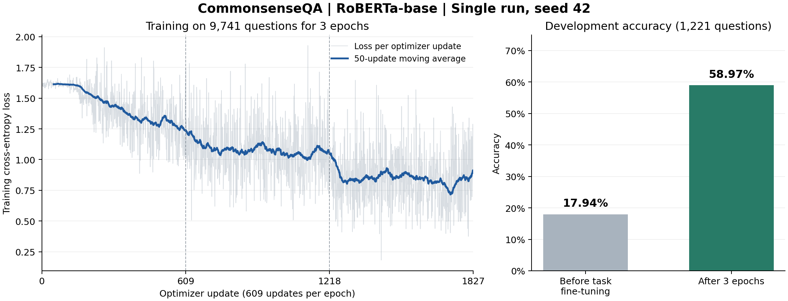

# CommonsenseQA 首次全量基线实验记录

本次完成 RoBERTa-base 在 CommonsenseQA 英文五选一任务上的首次全量监督微调。开发集 1221 题中答对 720 题，准确率为 **58.97%**。这是开发集结果，不是隐藏测试集成绩。

**实验做了什么。** 加载 `FacebookAI/roberta-base` 的预训练编码器，添加多项选择任务评分层，使用正确答案监督训练，联合更新编码器和任务层参数。这是首次全量微调；此前 256 题的运行用于检查流程。模型已有预训练权重，本次没有从头预训练语言模型。

| 设置 | 本次取值 |
|---|---|
| 数据集 | `tau/commonsense_qa`，保持官方划分 |
| 训练集 / 开发集 | 9741 / 1221 道题 |
| 任务 | 每题 5 个选项，预测正确选项；指标为 Accuracy |
| 训练轮数 / 参数更新 | 3 个 epoch / 1827 次更新 |
| 每批题数 / 梯度累积 | 1 / 16，有效批量为 16 题 |
| 最大序列长度 | 128，动态填充 |
| 优化器 / 峰值学习率 | AdamW / `2e-5` |
| 学习率调度 | 183 步预热，之后线性衰减 |
| 权重衰减 / 梯度裁剪上限 | 0.01 / 1.0 |
| 随机种子 | 42；本次为单次运行 |
| 计算环境 | Intel Core i5-1340P，CPU FP32，4 个计算线程，约 16 GB 内存 |

**训练结果。** 前后评估使用同一组 1221 道开发题，开发题不参与梯度计算或参数更新。训练开始前和三轮结束后各评估一次；最终模型为固定训练三轮后的模型，没有按开发集选取最佳轮次。

| 开发集指标 | 本任务微调前 | 微调 3 轮后 |
|---|---:|---:|
| 答对题数 | 219 / 1221 | 720 / 1221 |
| 准确率 | 17.94% | 58.97% |
| 交叉熵损失 | 1.6097 | 1.0798 |

准确率提高 **41.03 个百分点**，微调后仍有 501 道题回答错误。微调前的对照是“预训练编码器 + 随机初始化的任务层”，不是一个已经训练好的问答模型；17.94% 不能用来概括 RoBERTa 的全部能力。

训练耗时约 **5 小时 16 分钟**（18967.49 秒，不含前后开发集评估等全部启动收尾时间）。进程峰值私有内存约 **3.52 GiB**。全程平均训练 loss 为 **1.1170**；最后一次更新的 loss 为 **0.8927**，二者的统计范围不同。

| 轮次 | 本轮训练 loss 平均值（按日志更新步计算） |
|---|---:|
| 第 1 轮 | 1.4285 |
| 第 2 轮 | 1.0752 |
| 第 3 轮 | 0.8472 |

这些训练 loss 展示了对训练题的拟合过程，不能代替每轮开发集结果，也不能单独用来判断是否过拟合。

**已完成的核查。** 独立重算全部 1221 道预测，题目 ID、题目与选项、正确标签、预测选项和准确率均与保存的官方开发集一致。1827 次更新的训练 loss 和 grad_norm 均为有限值。编码器和任务评分层参数均发生变化。检查点文件齐全；模型及分词器离线重载后，两道核对题的输出最大绝对差为 0.0。临时防自动睡眠请求已随训练进程结束而释放。

**可以向老师这样汇报。**

> 我负责的 RoBERTa-base 常识问答基线已经完成第一次全量实验。我们在 CommonsenseQA 官方训练集的 9741 道题上进行三轮监督微调，在独立的 1221 道开发题上取得了 58.97% 的准确率，即答对 720 题；未经本任务微调的初始化模型为 17.94%，提高了 41.03 个百分点。实验在本机 CPU 上完成，训练约耗时 5 小时 16 分钟。训练损失逐轮下降，模型检查点、逐题预测和实验配置均已保存，保存后的重载检查也通过了。目前这是单个随机种子的首轮开发集结果，后续计划做错误案例分析和重复实验，以检查结果的稳定性。

**结论边界与后续工作。** 本次能够支持“这一微调流程在当前开发集上有效”的结论，尚未测得多随机种子的均值、标准差，没有隐藏测试集成绩。它记录的是所选 RoBERTa-base 基线的实现与实验，不应表述为原论文全部模型、配置和数值的严格复现，也不宜与其他论文的隐藏测试集分数直接比较。下一步可先分析答错的 501 道题，再在固定划分和配置下重复随机种子实验；若课程要求原论文配置复现，应单独核对模型与训练设置的一致性。

可追溯文件：

- `reports/commonsenseqa-paper-reading-notes.md`：原论文完整结果、实验设置及与本组结果的可比性分析。
- `reports/paper-table5-results.json`：原论文表 5 的结构化数值与来源记录。
- `reports/accuracy-evidence.md`：219/1221 与 720/1221 的来源、记录范围和逐题重算方法。
- `reports/initial-model-recheck.json`：事后重建初始模型的评估，复现原记录的微调前准确率和损失。
- `reports/full-roberta-base-before-predictions-recheck.jsonl`：初始模型补充评估的逐题预测；不是原运行当时的逐题文件。
- `configs/full.json`：本次训练配置。
- `requirements-lock.txt`、`environment-info.json`：依赖版本和环境记录。
- `reports/model-info.json`、`reports/data-info.json`：固定的模型、数据来源及校验信息。
- `reports/full-roberta-base.json`：完整实验报告及日志。
- `reports/full-roberta-base-predictions.jsonl`：1221 道逐题预测。
- `reports/full-result-verification.json`：独立重算与文件核查记录。
- `outputs/full-roberta-base/checkpoint-1827/`：最终模型、分词器和训练状态。
